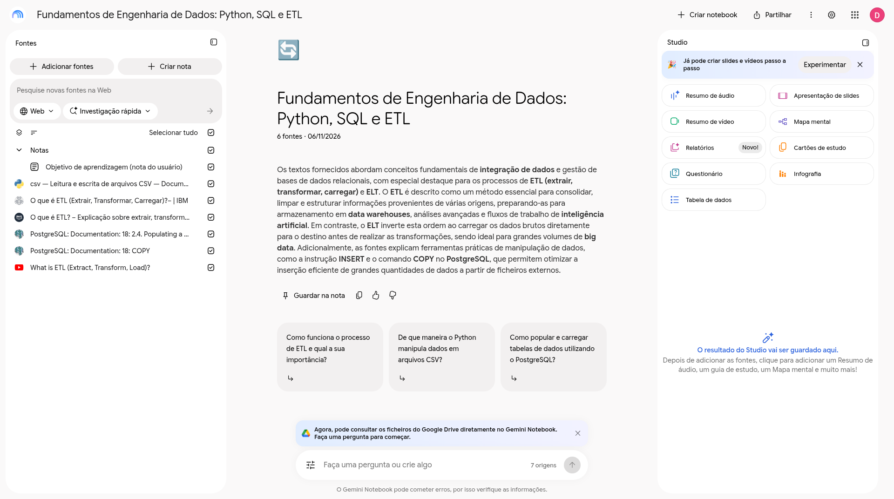
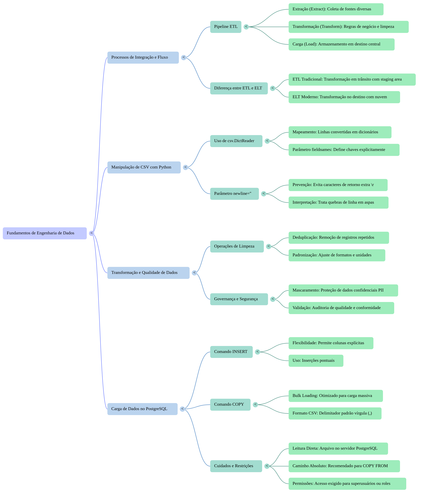
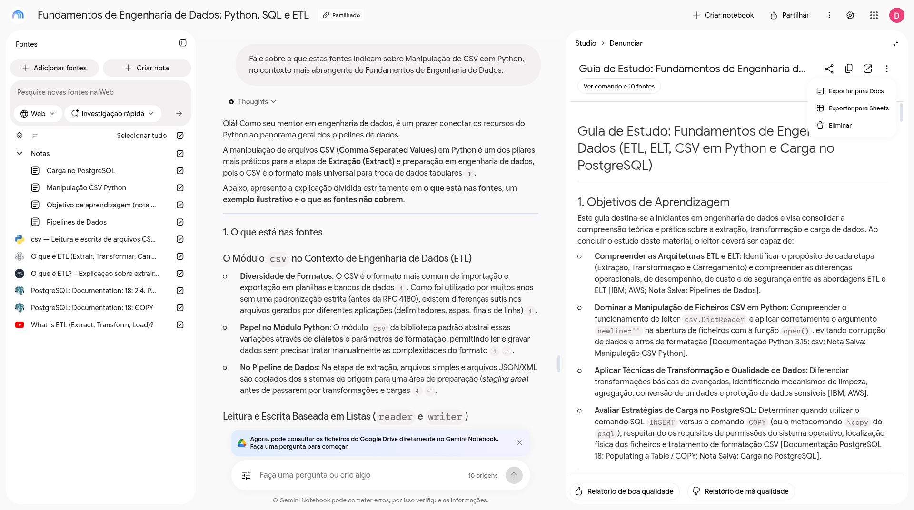

# Segundo cérebro: Fundamentos de Engenharia de Dados

Entrega de Diego para o desafio de segundo cérebro da DIO. O notebook se chama **Fundamentos de Engenharia de Dados: Python, SQL e ETL** e foi feito no Gemini Notebook. O objetivo era aprender, como iniciante, a extrair, transformar e carregar dados, validar CSV com Python e usar SQL básico no PostgreSQL.

Este repositório publica o que foi de fato feito: a instrução usada, as seis fontes, as quatro perguntas enviadas, as respostas originais, a revisão crítica, 13 capturas da interface e os dois materiais gerados no Estúdio. Os trechos imprecisos foram mantidos como evidência e estão anotados abaixo. Não há pipeline de código neste desafio.

## Descrição da entrega

Notebook com seis fontes externas e uma nota de objetivo, que não entra como fonte. Foram enviadas quatro mensagens: três perguntas técnicas e uma revisão crítica. O arquivo de perguntas planejadas tem cinco itens, e nem todos foram executados. O Estúdio gerou um mapa mental e um guia de estudo de 11 páginas. As respostas completas estão em [docs/respostas-reais.md](docs/respostas-reais.md). As capturas, o PDF e o mapa abrem sem conta do Notebook.

## Objetivo

Entender, na passagem para engenharia de dados, como extrair, transformar e carregar dados (ETL), validar CSV com Python e usar SQL básico no PostgreSQL.

A nota “Objetivo de aprendizagem (nota do usuário)” está no notebook para orientar as respostas. Ela não é uma das seis fontes.

## Onde está cada arquivo

| Caminho | Conteúdo |
|---|---|
| [docs/diretriz.txt](docs/diretriz.txt) | Instrução comportamental colada no notebook |
| [docs/fontes.md](docs/fontes.md) | Inventário das fontes, com o que foi lido em 06/11/2026 |
| [docs/perguntas.txt](docs/perguntas.txt) | Cinco perguntas planejadas; nem todas foram enviadas |
| [docs/respostas-reais.md](docs/respostas-reais.md) | Quatro respostas reais, com o texto original e o mapeamento das citações |
| [docs/notas-de-trabalho.md](docs/notas-de-trabalho.md) | Estado do trabalho, acesso e revisão crítica |
| [evidencias/](evidencias/MANIFESTO.md) | 13 capturas e o índice com SHA-256 |
| [materiais/](materiais/README.md) | Mapa mental e guia de estudo, sem edição posterior |

## Notebook e acesso

Link compartilhado: https://notebook.google.com/notebook/40659bdb-f98b-4c16-b472-d093f14ed343

Abrir esse notebook exige login do Google. O link não é acessível de forma anônima.

- No Chrome anônimo, o endereço redirecionou para o login do Google Accounts. Nenhum conteúdo do notebook ficou visível. Não houve tentativa de entrar na conta nem de contornar a tela.
- No diálogo de compartilhamento da sessão do proprietário, a configuração foi reconfirmada: qualquer pessoa com o link pode ver, sem permissão de edição, com “Permitir cópias” desmarcado e sem convites.
- Não foi testado o acesso com outra conta Google já autenticada. O que está registrado é a barreira anônima de login e a configuração de compartilhamento do proprietário.
- Ao montar este repositório, um pedido HTTP sem credenciais também terminou na página de login do Google Accounts. Esse pedido não autentica ninguém e não substitui a checagem no Chrome.

As 13 capturas, o PDF e o mapa mental deste repositório podem ser lidos sem conta do Notebook. A visão geral capturada está em [evidencias/00-notebook-visao-geral.png](evidencias/00-notebook-visao-geral.png).



## Fontes

Há seis fontes externas. A nota de objetivo fica de fora dessa conta. Nas capturas iniciais o compositor mostra “7 origens”: as seis fontes mais a nota. Nas capturas posteriores o número sobe para 8, 9 ou 10 porque respostas foram salvas como notas do notebook. Essas notas não são documentos externos. O botão do guia, na captura do Estúdio, fala em 10 itens por esse mesmo motivo.

As páginas de texto foram lidas. A transcrição do vídeo foi importada e revista dentro do notebook. O vídeo não foi assistido de ponta a ponta. Não houve Deep Research. Nas capturas, o controle da Web está em “Investigação rápida”.

O arquivo [docs/fontes.md](docs/fontes.md) é o inventário de 06/11/2026. No item do vídeo, esse arquivo ainda dizia que a transcrição não tinha sido lida. O parágrafo final do mesmo arquivo registra a revisão feita depois da importação.

| Fonte | Idioma | Por que entrou | URL |
|---|---|---|---|
| “O que é ETL (extrair, transformar, carregar)?”, Alice Gomstyn e Amanda McGrath, IBM Think | PT-BR | Definição de ETL, comparação com ELT e descrição das três etapas. Texto de fornecedor, com viés comercial nos links de produto | https://www.ibm.com/br-pt/think/topics/etl |
| “O que é ETL (extrair, transformar e carregar)?”, AWS, sem autor nomeado | PT | Segunda visão de ETL e ELT, extração, transformação e carga. As seções finais promovem produtos AWS | https://aws.amazon.com/pt/what-is/etl/ |
| “csv — Leitura e escrita de arquivos CSV”, documentação do Python 3. A página no notebook mostra 3.15.2 | PT-BR | Fonte primária de `csv.DictReader` e de `newline=''`. A página cobre leitura e parsing, não validação de negócio | https://docs.python.org/pt-br/3/library/csv.html |
| “2.4. Populating a Table With Rows”, documentação PostgreSQL 18, URL `current` | EN | INSERT, o estilo de nomear colunas e a comparação com COPY, inclusive “usually faster” e o arquivo no servidor | https://www.postgresql.org/docs/current/tutorial-populate.html |
| “COPY”, referência SQL, documentação PostgreSQL 18, URL `current` | EN | Referência primária do comando: arquivo no servidor, formato CSV, HEADER, DELIMITER e permissões | https://www.postgresql.org/docs/current/sql-copy.html |
| “What is ETL (Extract, Transform, Load)?”, IBM Technology, cerca de 4 min 51 s | EN | Fonte em vídeo do canal oficial. Legendas públicas em inglês. Entrou a transcrição revista no notebook, não uma assistência integral do vídeo | https://www.youtube.com/watch?v=OW5OgsLpDCQ |

Os artigos e a transcrição não são copiados aqui. Os links acima é que apontam para o material de origem.

As quatro respostas abaixo citam IBM, AWS, a documentação do Python e a documentação do PostgreSQL. Nenhuma das numerações visíveis nessas respostas aponta para o vídeo.

## Instrução comportamental

Texto usado para orientar as respostas, também em [docs/diretriz.txt](docs/diretriz.txt):

> Comporte-se como um mentor especialista em fundamentos de engenharia de dados (Python, SQL e ETL) para iniciantes. Responda em português, apenas com base nas fontes do notebook, sempre com citações. Separe claramente o que está nas fontes, o que é um exemplo ilustrativo e o que as fontes não cobrem; nesse último caso, diga "as fontes não informam". Não invente comandos nem dados.

## Perguntas planejadas e perguntas feitas

[docs/perguntas.txt](docs/perguntas.txt) guarda cinco perguntas preparadas antes do chat. Foram enviadas quatro. A terceira e a quinta planejadas não foram feitas. A quarta planejada não foi enviada com aquele enunciado.

Planejadas:

1. Etapas do ETL e a diferença entre ETL e ELT na IBM e na AWS.
2. `csv.DictReader` e o pedido de `newline=''` na documentação.
3. Validações e limpezas citadas para a transformação, e o que o módulo `csv` oferece ou não oferece, com `Dialect.strict` e `Sniffer`. Esta não foi enviada.
4. Quando a documentação do PostgreSQL indica INSERT ou COPY, e quais opções de COPY valem para CSV (`HEADER`, `DELIMITER`, `ON_ERROR`). O chat não usou este enunciado.
5. Diferença entre carga completa, inicial e incremental segundo IBM e AWS, mais um roteiro curto só com estas fontes. Esta não foi enviada.

Feitas, nesta ordem:

1. Quais são as três etapas do ETL e como IBM e AWS diferenciam ETL de ELT?
2. Como ler um CSV em Python com `csv.DictReader` e por que a documentação pede `newline=''` ao abrir o arquivo?
3. Segundo a documentação do PostgreSQL, quando usar INSERT e quando usar COPY, e quais cuidados valem para CSV e a localização do arquivo?
4. Revisão crítica da resposta anterior: COPY é geralmente mais rápido, não necessariamente de forma significativa; a conta do sistema que executa o PostgreSQL não precisa se chamar `postgres`; em Python, distinguir a recomendação de `newline=''` de uma exigência absoluta. Confirmar ou corrigir com citações.

O guia de estudo repete temas de carga e traz um questionário próprio do Estúdio. Esse questionário não é a quinta pergunta do chat.

## Respostas

O texto integral gerado, inclusive as frases imprecisas e os exemplos, está em [docs/respostas-reais.md](docs/respostas-reais.md). Os resumos abaixo acompanham as citações que a própria resposta numerou e os painéis que foram abertos. Onde a redação original aperta a documentação além do trecho conferido, a anotação vem em seguida e o original permanece no arquivo.

### 1. Etapas do ETL e diferença para ELT

A resposta separa o que está nas fontes, um exemplo e o que as fontes não cobrem.

Nas fontes, ETL é extrair, transformar e carregar. A extração tira dados brutos de várias origens e os leva a uma área de preparação. A transformação aplica limpeza, deduplicação, padronização, filtros, agregações, cálculos, junção ou separação de colunas e mascaramento de dados confidenciais. A carga leva o resultado ao destino e pode ser inicial, incremental ou contínua. IBM e AWS colocam a diferença central na ordem e no lugar da transformação: no ETL ela ocorre em trânsito, antes da carga; no ELT os dados brutos entram primeiro e a transformação ocorre no destino. A IBM ainda associa ETL a dados estruturados e esquema na escrita, e ELT a volumes maiores, com diferenças de velocidade, custo e privacidade. A AWS destaca a ausência de uma área de preparação separada e o efeito da computação em nuvem. O exemplo do CSV de vendas em dólares, convertido para reais antes do PostgreSQL, está marcado como hipotético.

A resposta diz que as fontes não trazem um pipeline pronto de ELT em Python ou SQL nem tempos medidos de ETL contra ELT.

Citações visíveis e fontes originais:

- [1], [5], [9], [13] e [17]: IBM Think, https://www.ibm.com/br-pt/think/topics/etl
- [3], [16] e [18]: AWS, https://aws.amazon.com/pt/what-is/etl/

Painéis abertos: [1] e [9] na IBM, [16] na AWS. Os outros números dessa resposta não foram abertos um a um. As capturas são [a resposta](evidencias/q1-resposta-etl-elt.png), [o painel da IBM](evidencias/q1-citacao-ibm.png) e [o painel da AWS](evidencias/q1-citacao-aws.png).

### 2. `csv.DictReader` e `newline=''`

A resposta diz que `DictReader` mapeia cada linha para um dicionário. Sem `fieldnames`, a primeira linha vira o conjunto de chaves e não entra nos dados. Com `fieldnames`, a primeira linha é tratada como dado. A ordem das colunas se mantém. Sobre `newline=''`, o texto original afirma que a documentação “exige” esse argumento em `open()`, para ler quebras de linha dentro de campos entre aspas, para não gravar um `\r` extra em plataformas com final `\r\n` e porque o módulo `csv` faz o próprio tratamento de quebras. O exemplo com `names.csv` está marcado como adaptado da documentação.

A resposta diz que as fontes não comparam memória ou velocidade de `DictReader` com `csv.reader` e não descrevem uma estratégia para bytes corrompidos além do parâmetro `encoding`.

Anotação, sem apagar o original: `newline=''` é a recomendação do módulo `csv` para o tratamento de quebras de linha. A formulação conferida no painel é da ordem de “deverá ser aberto com” e “é sempre seguro”. Não é exigência sintática para `open()` conseguir abrir o arquivo. A frase “exige-se” fica na resposta preservada como evidência do exagero.

Citações [1] a [6], todas na mesma página: documentação do Python, https://docs.python.org/pt-br/3/library/csv.html

Painéis abertos: [1], o `DictReader`, e [4], a nota de rodapé de `newline=''`. Capturas: [a resposta](evidencias/q2-resposta-csv-dictreader.png), [o painel do DictReader](evidencias/q2-citacao-dictreader.png) e [a nota de `newline=''`](evidencias/q2-citacao-newline.png).

### 3. INSERT, COPY, CSV e localização do arquivo

A resposta apresenta INSERT como inclusão de linhas, com liberdade para nomear colunas, mudar a ordem ou omitir colunas que recebem padrão. Apresenta COPY como carga ou exportação de volumes grandes em arquivo texto, com menos flexibilidade. O texto original diz que COPY é “significativamente mais rápido” que INSERT.

Anotação: o painel aberto da seção 2.4 diz “usually faster”. A leitura que fica de pé é que COPY é geralmente mais rápido, não necessariamente de forma significativa. A frase “significativamente mais rápido” permanece na resposta original.

No CSV, a resposta reúne `FORMAT csv`, delimitador vírgula, a diferença entre NULL e string vazia, `FORCE_NULL` e `FORCE_NOT_NULL`, aspas e escape, `HEADER` e `HEADER MATCH`, e o fato de os espaços serem significativos. Sobre o lugar do arquivo, diz que o COPY SQL lê no servidor, que caminho absoluto é o recomendado e que o metacomando `\copy` do psql lê o arquivo na máquina do cliente. Os exemplos SQL estão marcados como sintaxe descrita na documentação. Eles não foram executados neste desafio.

A resposta original chama a conta do sistema de “usuário postgres”.

Anotação: o painel define essa conta como o ID de usuário sob o qual o servidor executa (“the user ID the server runs as”). O nome não precisa ser `postgres`.

A resposta também cita a restrição a superusuários ou aos papéis `pg_read_server_files`, `pg_write_server_files` e `pg_execute_server_program`. Diz que as fontes não dão tempos medidos nem explicam NFS, S3 ou SMB.

Citações e fontes originais:

- [1] a [3]: PostgreSQL 18, 2.4. Populating a Table With Rows, https://www.postgresql.org/docs/current/tutorial-populate.html
- [4] a [15]: PostgreSQL 18, COPY, https://www.postgresql.org/docs/current/sql-copy.html

Painéis abertos: [3], [5], [6], [7], [12], [14] e [15]. Os números [8], [9], [10], [11] e [13] não foram abertos. Capturas: [a resposta](evidencias/q3-resposta-insert-copy.png) e [o painel de COPY, velocidade e localização](evidencias/q3-citacao-copy-localizacao.png).

### 4. Revisão crítica

A quarta mensagem pede para corrigir os três pontos acima e citar de novo. A resposta confirma que a documentação diz “usually faster” e não usa “significativamente mais rápido”; que a conta é o ID sob o qual o servidor executa, sem exigir o nome `postgres`; e que `newline=''` não é uma trava de sintaxe de `open()`. O comentário do exemplo em Python ainda diz “boa prática exigida”, e um trecho ainda chama o argumento de “exigência operacional”.

Anotação: a distinção útil já está no corpo dessa resposta, e o resíduo fica no comentário e na palavra “exigência”. Para o módulo `csv`, `newline=''` é recomendação de tratamento de quebras de linha. Para o PostgreSQL, COPY é geralmente mais rápido, e a conta do sistema é a que executa o servidor.

Citações conferidas no painel:

- [1]: PostgreSQL, 2.4, https://www.postgresql.org/docs/current/tutorial-populate.html — captura [q4-revisao-copy-usually-faster.png](evidencias/q4-revisao-copy-usually-faster.png)
- [2] e [3]: PostgreSQL, COPY, https://www.postgresql.org/docs/current/sql-copy.html — captura [q4-revisao-usuario-so.png](evidencias/q4-revisao-usuario-so.png)
- [4] e [5]: documentação do Python, https://docs.python.org/pt-br/3/library/csv.html — captura [q4-revisao-newline.png](evidencias/q4-revisao-newline.png)

## Três correções que acompanham o texto original

Estas três leituras valem para as respostas e também para o guia. O texto gerado não foi reescrito.

1. COPY é geralmente mais rápido que INSERT para grande volume em arquivo texto. A documentação conferida diz “usually faster”. Ela não diz que a diferença seja necessariamente significativa.
2. Quem precisa ler o arquivo no COPY SQL é a conta do sistema operacional sob a qual o servidor executa. Essa conta não precisa se chamar `postgres`.
3. `newline=''` é a recomendação do módulo `csv` para o tratamento de quebras de linha, em especial campos entre aspas e a gravação em finais `\r\n`. Não é exigência sintática para `open()` funcionar.

## Materiais do Estúdio

Os dois arquivos estão em [materiais/](materiais/README.md), nos bytes exportados.

### Mapa mental

[materiais/mapa-mental-fundamentos-engenharia-de-dados.png](materiais/mapa-mental-fundamentos-engenharia-de-dados.png)

PNG de 4787×5537 pixels, exportado por “Download mindmap as image”. Há quatro ramos: processo ETL e diferença para ELT; CSV com `DictReader` e `newline=''`; transformação e qualidade; carga no PostgreSQL com INSERT, COPY e cuidados de arquivo. O mapa não tem citações próprias. As fontes são as da seção [Fontes](#fontes).



### Guia de estudo

[materiais/guia-estudo-fundamentos-engenharia-dados.pdf](materiais/guia-estudo-fundamentos-engenharia-dados.pdf)

**Saída de IA não editada. Exige revisão crítica. Não é autoridade técnica verificada de forma independente.**

O título interno é “Guia de Estudo: Fundamentos de Engenharia de Dados (ETL, ELT, CSV em Python e Carga no PostgreSQL)”. São 11 páginas, produzidas pelo renderizador do Google Docs. O documento do Docs ficou privado e não tem link público aqui. O PDF deste repositório é a cópia legível sem conta.

O texto extraído tem objetivos, ETL/ELT, `DictReader`, transformação, INSERT/COPY, erros comuns, dez perguntas curtas com gabarito, cinco perguntas abertas e glossário. A última página termina no glossário. Nenhuma página saiu em branco. A contagem ficou entre 74 e 490 palavras por página. Isso é leitura do texto, não uma revisão linha a linha do layout.

O que o PDF ainda afirma, e por que não fecha a questão:

- A seção “A Exigência Operacional de newline=''” diz que “é imperativo declarar o argumento newline=''” e fala em “esta exigência”. Essa formulação continua mais forte do que a recomendação do módulo `csv`.
- Dezenas de referências citam “Nota Salva: …”, como “Nota Salva: Pipelines de Dados”, “Nota Salva: Manipulação CSV Python” e “Nota Salva: Carga no PostgreSQL”. São notas do notebook, não os documentos originais da IBM, da AWS, do Python ou do PostgreSQL.
- No desempenho, o PDF usa “geralmente/habitualmente mais rápido” (`usually faster`), alinhado ao painel. No gabarito, a conta do sistema ainda aparece “geralmente associada” ao usuário `postgres`, o que não torna esse nome obrigatório.

A captura do guia aberto no Estúdio é [evidencias/materiais-guia-estudo-tela.png](evidencias/materiais-guia-estudo-tela.png). O chat no centro dessa tela é um prompt automático do Estúdio sobre manipulação de CSV. Não são as perguntas 1 a 4.



## Como ler e conferir esta entrega

1. Ler a instrução em [docs/diretriz.txt](docs/diretriz.txt), as fontes em [docs/fontes.md](docs/fontes.md) e as perguntas planejadas em [docs/perguntas.txt](docs/perguntas.txt).
2. Ler as quatro respostas integrais em [docs/respostas-reais.md](docs/respostas-reais.md) e as anotações deste README. As linhas `original: <hash>.png` desse arquivo apontam para as capturas listadas em [evidencias/MANIFESTO.md](evidencias/MANIFESTO.md).
3. Abrir as capturas em [evidencias/](evidencias/MANIFESTO.md), o mapa e o PDF em [materiais/](materiais/README.md).
4. Conferir a integridade na raiz do repositório:

```bash
sha256sum evidencias/*.png materiais/*.png materiais/*.pdf
```

Os hashes esperados estão em [evidencias/MANIFESTO.md](evidencias/MANIFESTO.md). Cada captura PNG tem 1920×1072 pixels. O mapa tem 4787×5537. O PDF tem 11 páginas e assinatura `%PDF`.

5. O notebook em si só abre com login do Google. O Chrome anônimo não mostra o conteúdo. Não há, nesta entrega, um passo anônimo que revele as fontes dentro do produto, nem um teste com outra conta autenticada.
6. Não há código de ETL para instalar ou rodar. Os blocos Python e SQL nas respostas são exemplos do notebook, não um carregamento executado.

## Revisão crítica e limites

- A diretriz pedia separação entre fonte, exemplo e lacuna, e as quatro respostas seguem esse esqueleto. O produto avisa, no rodapé das capturas, que o Gemini Notebook pode errar. A quarta pergunta existe por causa disso.
- Nem toda citação numerada foi aberta. Na primeira resposta, os painéis vistos foram [1], [9] e [16]. Na segunda, [1] e [4]. Na terceira, [3], [5], [6], [7], [12], [14] e [15]. Na quarta, [1] a [5] foram abertos.
- A segunda resposta e o PDF ainda tratam `newline=''` como exigência. A quarta resposta corrige o núcleo e deixa “boa prática exigida” no comentário do exemplo.
- A terceira resposta diz “significativamente mais rápido” e “usuário postgres”. A quarta resposta e o painel reduzem isso a “usually faster” e ao ID da conta que executa o servidor. O PDF acompanha “usually faster” e ainda associa o nome `postgres` de forma geral.
- O guia cita notas salvas como se fossem fonte. O mapa não cita nada. Quem for estudar por eles precisa voltar aos links da seção de fontes e às respostas.
- A transcrição do vídeo foi revista no notebook. O vídeo completo não foi assistido. Deep Research não foi usado.
- As perguntas planejadas sobre `Dialect.strict`, `Sniffer` e o roteiro de carga completa, inicial e incremental não foram enviadas no chat.
- As capturas mostram só o avatar “D”. Não há e-mail, telefone nem nome completo nelas. Esta página também não publica contato nem localização.
- A checagem de acesso anônimo mostrou a tela de login. Ela não demonstra que outra pessoa, já autenticada no Google, consiga abrir o notebook só com o link. A configuração vista pelo proprietário é visualização, sem edição, sem cópia e sem convites.
